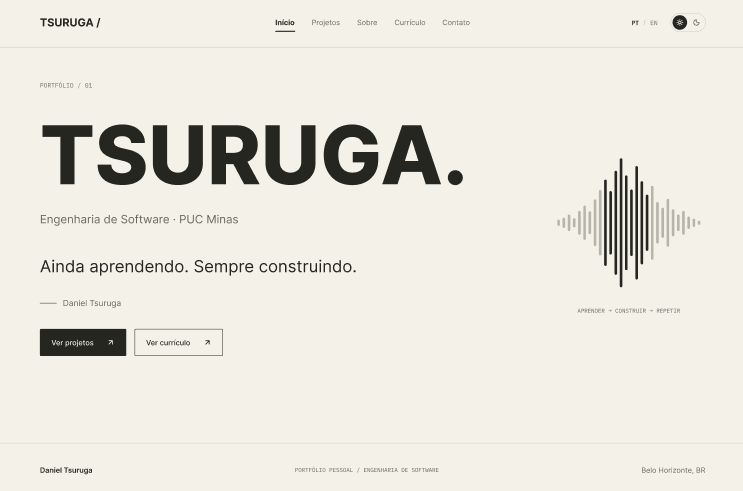
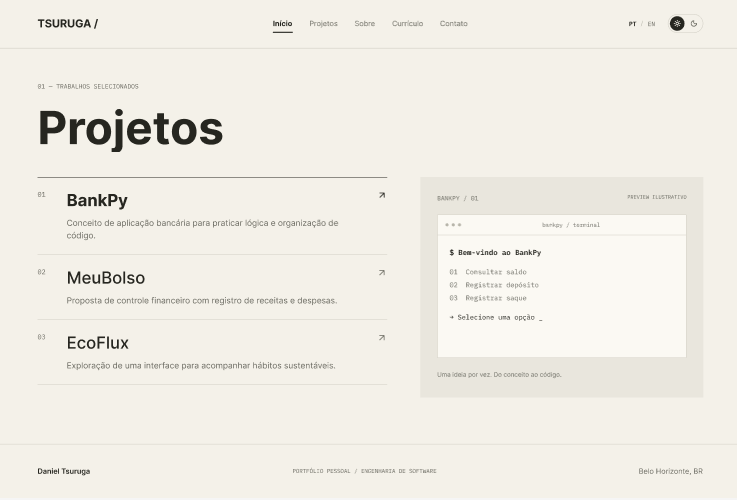
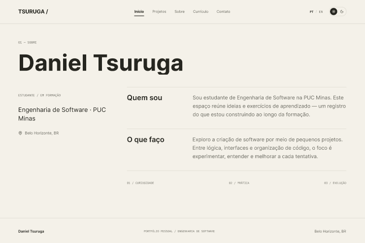
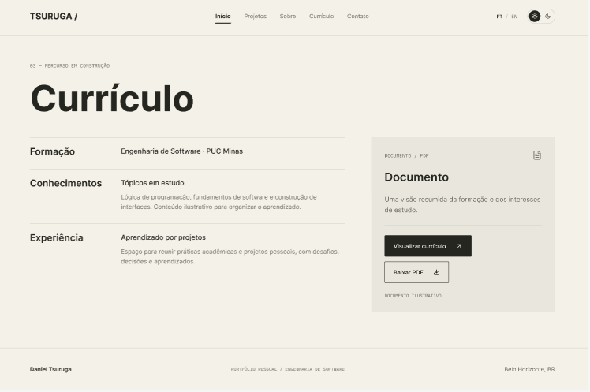
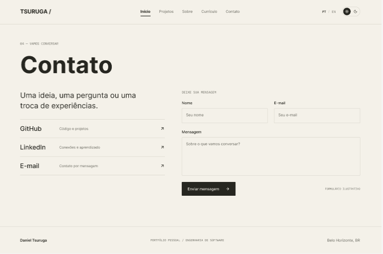

# 🧑‍💻 Portfólio Profissional — Daniel Tsuruga

> [!NOTE]
> Website de portfólio profissional desenvolvido para apresentar minha trajetória,
> habilidades e projetos.
> Projeto da disciplina **Desenvolvimento e Integração de Aplicações Web (DIAW)** —
> Engenharia de Software, PUC Minas.

---

## 🚧 Status do Projeto


### 🌐 Acesse o site publicado: **[danieltsuruga-portifolio.vercel.app](https://danieltsuruga-portifolio.vercel.app/)**

> 🟢 **Sprint atual:** Lab01S03 — Hospedagem e finalização.

---

## 📚 Índice

- [Sobre o Projeto](#-sobre-o-projeto)
- [Funcionalidades Principais](#-funcionalidades-principais)
- [Tecnologias Utilizadas](#-tecnologias-utilizadas)
- [Protótipos e Design](#-protótipos-e-design)
- [Estrutura de Pastas](#-estrutura-de-pastas)
- [Instalação e Execução](#-instalação-e-execução)
  - [Pré-requisitos](#pré-requisitos)
  - [Passo a passo](#passo-a-passo)
  - [Scripts disponíveis](#scripts-disponíveis)
  - [Variáveis de ambiente](#variáveis-de-ambiente)
- [Deploy](#-deploy)
- [Demonstração](#-demonstração)
- [Documentações Utilizadas](#-documentações-utilizadas)
- [Autor](#-autor)
- [Licença](#-licença)

---

## 📝 Sobre o Projeto

Este é o meu **portfólio profissional**, desenvolvido como projeto da disciplina
**Desenvolvimento e Integração de Aplicações Web (DIAW)** do curso de
**Engenharia de Software da PUC Minas**.

O objetivo é reunir, em um único lugar, as informações mais relevantes sobre a minha
trajetória acadêmica e profissional, apresentando:

- Quem eu sou e meus objetivos profissionais (em **português** e **inglês**);
- Os **projetos** que desenvolvi;
- Minhas **experiências** profissionais e acadêmicas;
- Formas de **contato** direto.

O site foi construído com foco em **design responsivo**, **boa usabilidade** e uma
**identidade visual coerente** com o meu perfil profissional.

> **Sobre mim:** Estudante de Engenharia de Software na PUC Minas 2º período,
> com interesse em desenvolvimento de softwares.
> Objetivo profissional: Evoluir constantemente, buscando conhecimento, independência e crescimento pessoal e profissional.

---

## ✨ Funcionalidades Principais

> As funcionalidades abaixo representam o escopo planejado do portfólio.
> O status indica o que já foi implementado em cada sprint.

- 🌐 **Internacionalização (i18n):** conteúdo disponível em **português** e **inglês**. ⏳ _Planejado_
- 👤 **Sobre Mim:** apresentação pessoal com formação, atuação, interesses e objetivos. ⏳ _Planejado_
- 🗂️ **Projetos:** linha do tempo (timeline) com nome, descrição, tecnologias, link do GitHub e imagem/GIF de cada projeto. ⏳ _Planejado_
- 💼 **Experiências:** histórico profissional/acadêmico com instituição, cargo, período e descrição. ⏳ _Planejado_
- 📬 **Contato:** ícones clicáveis (e-mail, WhatsApp, LinkedIn) e formulário com envio de e-mail. ⏳ _Planejado_
- 🎨 **Temas:** alternância entre tema claro e escuro. ⏳ _Planejado_
- 📱 **Design responsivo:** adaptação a desktop, tablet e mobile. ⏳ _Planejado_

---

## 🛠 Tecnologias Utilizadas

As seguintes ferramentas, bibliotecas e serviços foram (ou serão) utilizados na
construção deste projeto.

### 💻 Front-end

| Tecnologia | Versão | Descrição |
| :--- | :--- | :--- |
| [React](https://react.dev/) | 19 | Biblioteca JavaScript para construção da interface em componentes. |
| [React Router](https://reactrouter.com/) | 7 | Roteamento entre as páginas (navegação sem recarregar). |
| [Vite](https://vite.dev/) | 8 | Build tool e servidor de desenvolvimento rápido. |
| [react-icons](https://react-icons.github.io/react-icons/) | 5 | Ícones (GitHub, LinkedIn, WhatsApp, e-mail) na página de contato. |
| JavaScript (ES6+) | — | Linguagem de programação principal do projeto. |
| CSS Modules | — | Estilização com escopo isolado por componente + variáveis CSS (tokens). |

### ☁️ Serviços / Integrações

| Tecnologia | Descrição |
| :--- | :--- |
| [EmailJS](https://www.emailjs.com/) | Envio do formulário de contato por e-mail, direto do front-end. ✅ _Implementado_ |
| [Supabase](https://supabase.com/) | Backend como serviço (banco de dados PostgreSQL e APIs) para dados dinâmicos. ⏳ _Planejado_ |

### 🚀 Infraestrutura & Deploy

| Tecnologia | Descrição |
| :--- | :--- |
| [Vercel](https://vercel.com/) | Hospedagem do front-end com deploy contínuo a partir do GitHub. ⏳ _Planejado_ |
| [Git](https://git-scm.com/) & [GitHub](https://github.com/) | Controle de versão e hospedagem do código-fonte. |

### 🔧 Ferramentas de Desenvolvimento

| Ferramenta | Versão | Descrição |
| :--- | :--- | :--- |
| [oxlint](https://oxc.rs/docs/guide/usage/linter) | 1 | Linter para análise estática e qualidade de código. |
| [@vitejs/plugin-react](https://github.com/vitejs/vite-plugin-react) | 6 | Plugin oficial do React para o Vite. |

> [!NOTE]
> Esta lista será atualizada conforme novas bibliotecas forem adicionadas ao projeto
> (ex: biblioteca de roteamento, formulários, envio de e-mail, etc.).

---

## 🎨 Protótipos e Design

O design e o protótipo navegável deste portfólio foram elaborados antes do
desenvolvimento, servindo como referência visual para a implementação.

- 🔗 **Protótipo navegável (Figma):** [Abrir protótipo](https://www.figma.com/proto/02rX9FrzEAHay8oHujkP1u/Portf%C3%B3lio-Daniel-Tsuruga-%E2%80%94-Wireframes)
- 🎨 **Protótipo de alta fidelidade (Lovable):** <https://pixel-perfect-render-1506.lovable.app>

### 🖼️ Wireframes das telas

| Início | Projetos |
| :---: | :---: |
|  |  |
| **Sobre** | **Currículo** |
|  |  |
| **Contato** | |
|  | |

> [!NOTE]
> Os wireframes acima (média fidelidade) foram criados no Figma e usados como
> referência para o desenvolvimento do site.

---

## 📂 Estrutura de Pastas

A estrutura abaixo descreve a organização atual do projeto (front-end em React + Vite).

```
danieltsuruga-portifolio/
├── docs/                       # 📚 Documentação e protótipos
│   └── prototipos/             # 🖼️ Wireframes das telas (usados no README)
├── public/                     # 📂 Arquivos estáticos servidos diretamente (favicon, etc.)
├── src/                        # 📂 Código-fonte da aplicação
│   ├── assets/                 # 🖼️ Imagens e recursos importados no código
│   ├── components/             # 🧱 Componentes reutilizáveis
│   │   ├── Header.jsx           #    Barra de navegação do topo (menu, idioma, tema)
│   │   ├── Header.module.css
│   │   ├── Footer.jsx           #    Rodapé (mini-waveform + ano dinâmico)
│   │   ├── Footer.module.css
│   │   ├── Waveform.jsx         #    Onda sonora animada (reutilizável via props)
│   │   └── Waveform.module.css
│   ├── pages/                  # 📄 Páginas (uma por rota)
│   │   ├── Home.jsx             #    Início (/)
│   │   ├── Home.module.css
│   │   ├── Projects.jsx         #    Projetos (/projetos)
│   │   ├── About.jsx            #    Sobre (/sobre)
│   │   ├── Resume.jsx           #    Currículo (/curriculo)
│   │   └── Contact.jsx          #    Contato (/contato)
│   ├── hooks/                  # 🎣 Hooks personalizados
│   │   └── useTheme.js          #    Lógica de tema (estado + persistência)
│   ├── App.jsx                 # 🧩 Componente raiz: define as rotas
│   ├── main.jsx                # 🚪 Ponto de entrada: renderiza o App no HTML
│   └── index.css               # 🎨 Estilos globais (tokens de design e temas)
├── index.html                  # 📄 Página HTML base onde o React é injetado
├── package.json                # 📦 Dependências, scripts e metadados do projeto
├── package-lock.json           # 🔒 Versões exatas das dependências instaladas
├── vite.config.js              # ⚙️ Configuração do Vite
├── .gitignore                  # 🧹 Arquivos e pastas ignorados pelo Git
└── README.md                   # 📘 Documentação do projeto (este arquivo)
```

---

## 🔧 Instalação e Execução

Siga os passos abaixo para rodar o projeto localmente na sua máquina.

### Pré-requisitos

- [Node.js](https://nodejs.org/) versão **18 ou superior** (recomendado: LTS)
- [npm](https://www.npmjs.com/) (instalado junto com o Node.js) ou outro gerenciador de pacotes
- [Git](https://git-scm.com/)

### Passo a passo

```bash
# 1. Clone o repositório
git clone https://github.com/DanielTsuruga/danieltsuruga-portifolio.git

# 2. Acesse a pasta do projeto
cd danieltsuruga-portifolio

# 3. Instale as dependências
npm install

# 4. Rode o projeto em modo de desenvolvimento
npm run dev
```

Após executar `npm run dev`, o terminal exibirá um endereço local
(geralmente <http://localhost:5173>). Abra esse endereço no navegador para
visualizar o portfólio.

### Scripts disponíveis

| Script | Comando | Descrição |
| :--- | :--- | :--- |
| Desenvolvimento | `npm run dev` | Inicia o servidor local de desenvolvimento. |
| Build | `npm run build` | Gera a versão otimizada para produção na pasta `dist/`. |
| Preview | `npm run preview` | Visualiza localmente a versão de produção gerada. |
| Lint | `npm run lint` | Analisa o código em busca de problemas de qualidade. |

### Variáveis de ambiente

O formulário de contato usa o **EmailJS**, que precisa de três variáveis de
ambiente. Crie um arquivo **`.env`** na raiz do projeto (use o `.env.example`
como modelo) com os seus valores:

```env
# EmailJS (https://www.emailjs.com/)
VITE_EMAILJS_SERVICE_ID=seu_service_id_aqui
VITE_EMAILJS_TEMPLATE_ID=seu_template_id_aqui
VITE_EMAILJS_PUBLIC_KEY=sua_public_key_aqui
```

> [!NOTE]
> No Vite, as variáveis precisam do prefixo `VITE_`. O arquivo `.env` **não é
> versionado** (está no `.gitignore`); por isso, em produção, essas variáveis
> também devem ser cadastradas no painel da Vercel.

---

## 🚀 Deploy

O site está hospedado na **[Vercel](https://vercel.com/)**, com publicação
automática a cada atualização enviada para a branch principal do repositório no GitHub.

- 🌐 **Site publicado:** <https://danieltsuruga-portifolio.vercel.app/>

> [!NOTE]
> O formulário de contato usa o **EmailJS**. Para o envio funcionar em produção,
> as variáveis de ambiente (`VITE_EMAILJS_*`) estão configuradas no painel da
> Vercel (Project Settings → Environment Variables), já que o arquivo `.env`
> não é versionado.

---

## 🎥 Demonstração

> [!NOTE]
> As imagens e GIFs demonstrando o site e os projetos em funcionamento serão
> adicionados aqui ao longo do desenvolvimento (previsto para a Sprint Lab01S03).

---

## 🔗 Documentações Utilizadas

- 📖 [Documentação oficial do React](https://react.dev/)
- 📖 [Guia de configuração do Vite](https://vite.dev/config/)
- 📖 [Documentação do Supabase](https://supabase.com/docs)
- 📖 [Documentação da Vercel](https://vercel.com/docs)
- 📖 [Conventional Commits (padrão de mensagens de commit)](https://www.conventionalcommits.org/pt-br/v1.0.0/)

---

## 👤 Autor

| Nome | GitHub | LinkedIn | E-mail |
| :--- | :--- | :--- | :--- |
| **Daniel Tsuruga** | [@DanielTsuruga](https://github.com/DanielTsuruga) | [Linkedin](https://www.linkedin.com/in/daniel-eiji-tsuruga-b6983b443/) | daniel.tsuruga@gmail.com |

---

## 📄 Licença

Este projeto está licenciado sob a **Licença MIT**. Consulte o arquivo
[LICENSE](LICENSE) para mais detalhes.

---

> Projeto acadêmico desenvolvido para a disciplina **DIAW** —
> Prof. Dr. João Paulo Carneiro Aramuni · Engenharia de Software · PUC Minas.
